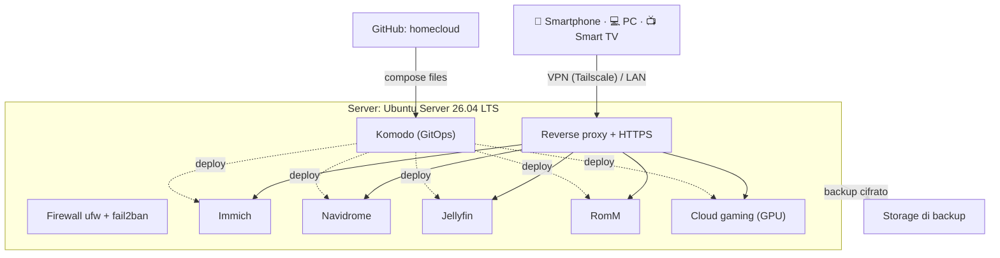

# 🏠 HomeCloud

Piattaforma cloud personale **self-hosted** su un portatile riconvertito a server, costruita con **Docker** e gestita secondo i principi di **Infrastructure as Code** e **GitOps**.

L'obiettivo è sostituire servizi commerciali (foto, musica, media, gaming) con alternative open source, mantenendo il pieno controllo dei dati e un'infrastruttura riproducibile, sicura e monitorata.

---

## ✨ Funzionalità

| Area | Servizio | Descrizione |
|---|---|---|
| 📷 Foto e video | [Immich](https://immich.app) | Backup automatico dallo smartphone, album, ricerca, riconoscimento facciale |
| 🎵 Musica | [Navidrome](https://www.navidrome.org) | Streaming della libreria musicale personale, app compatibili Subsonic |
| 📺 Media su TV | [Jellyfin](https://jellyfin.org) | Foto, video e musica sulla smart TV, transcodifica hardware Intel Quick Sync |
| 🕹️ Retrogaming | [RomM](https://romm.app) | Catalogo della collezione retro con metadati e gioco nel browser |
| 🎮 Cloud gaming in LAN | Dolphin + Selkies / Sunshine-Moonlight | Giochi eseguiti sul server con GPU e trasmessi alla TV, smartphone come controller |
| 🧭 Gestione | [Komodo](https://komo.do) | Deploy degli stack Docker direttamente da questo repository (GitOps) |
| 🏠 Portale | Homepage / Homarr | Punto di accesso unico a tutti i servizi |

> I contenuti multimediali e i giochi provengono da copie legalmente possedute.

---

## 🏗️ Architettura



---

## 🖥️ Hardware

| Componente | Specifiche |
|---|---|
| Modello | Lenovo IdeaPad L340-15IRH Gaming |
| CPU | Intel Core i5-9300H (4C/8T), iGPU UHD 630 con Quick Sync |
| RAM | 16 GB DDR4 |
| GPU | NVIDIA GeForce GTX 1650 4 GB |
| Storage | NVMe 512 GB con LVM: 98 GB sistema, 350 GB dati (`/srv/data`) |
| OS | Ubuntu Server 26.04 LTS |

---

## 🧰 Stack tecnologico

- **Sistema:** Linux (Ubuntu Server), systemd, LVM, netplan
- **Sicurezza:** SSH a chiavi, ufw, fail2ban, aggiornamenti automatici
- **Container:** Docker Engine, Docker Compose, Komodo
- **Rete:** reverse proxy con HTTPS, Tailscale
- **Operatività:** backup restic (3-2-1), monitoring Uptime Kuma / Prometheus / Grafana
- **Automazione:** GitHub Actions, Ansible
- **Gaming:** GPU NVIDIA nei container, streaming WebRTC

---

## 🗺️ Roadmap

| Fase | Contenuto | Stato |
|---|---|---|
| 0. Preparazione | Repository, inventario hardware, installazione OS | ✅ Completata |
| 1. Fondamenta Linux | SSH a chiavi, firewall e fail2ban, storage LVM | ✅ Completata |
| 2. Docker | Docker Engine, container, volumi, reti, Compose | 🔄 In corso |
| 3. Infrastruttura | Reverse proxy HTTPS, accesso remoto via VPN, Komodo | ⏳ |
| 4. Servizi | Immich, Navidrome, Jellyfin, RomM, portale | ⏳ |
| 4G. Gaming | GPU nei container, game streaming, Dolphin, port nativi | ⏳ |
| 5. Operatività | Backup con test di ripristino, monitoring, CI | ⏳ |
| 6. Verso il cloud | Ansible, servizio su free tier cloud, documentazione finale | ⏳ |

Il dettaglio di ogni attività è tracciato nelle [Issues](../../issues) e nel board del progetto.

---

## 📁 Struttura del repository

```
homecloud/
├── .github/ISSUE_TEMPLATE/   # template delle issue
├── docs/                     # documentazione tecnica (storage, rete, servizi…)
└── stacks/                   # un docker-compose per ogni servizio
```

I segreti (password, token) non sono mai versionati: si trovano in file `.env` esclusi tramite `.gitignore`.

---

## 📐 Metodo di lavoro

- Ogni attività è una **issue** con task, criteri di accettazione e note tecniche.
- Avanzamento gestito con **milestone** per fase e board **Kanban**.
- Tutta la configurazione è **versionata**: il server deve poter essere ricostruito da questo repository.
